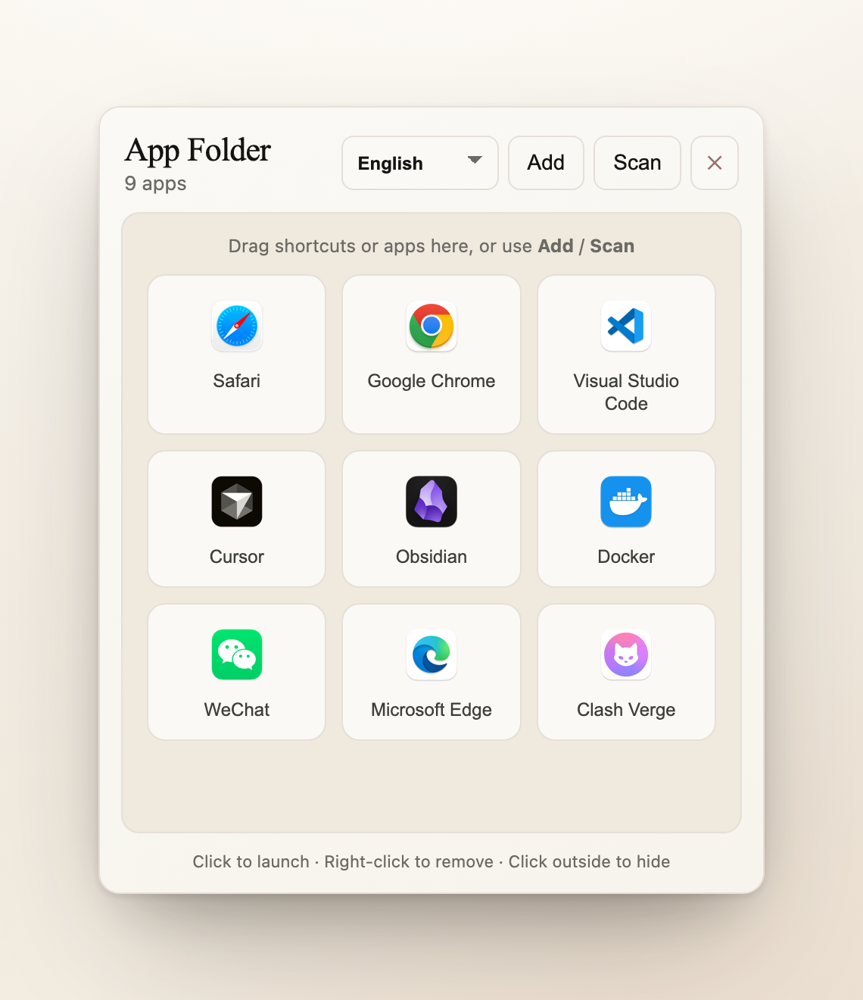
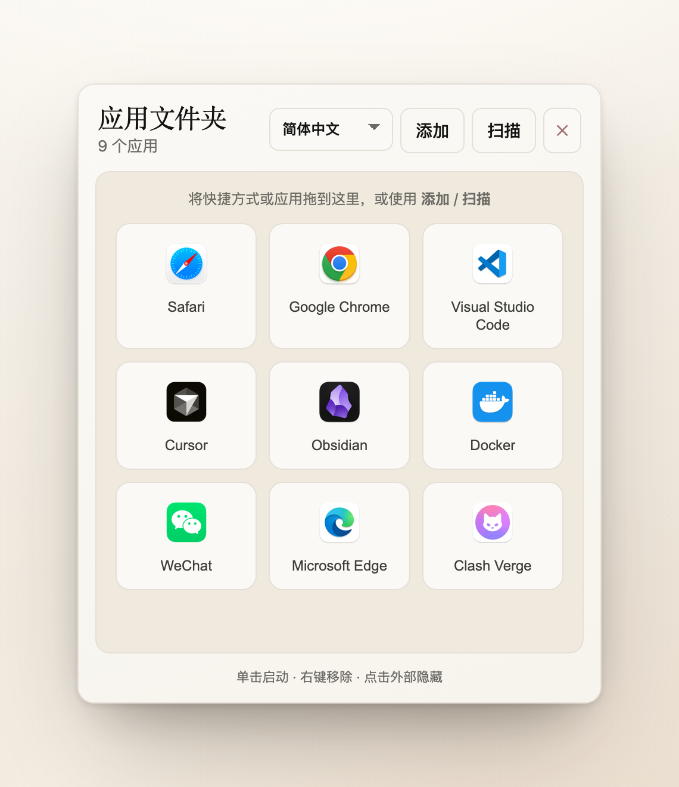
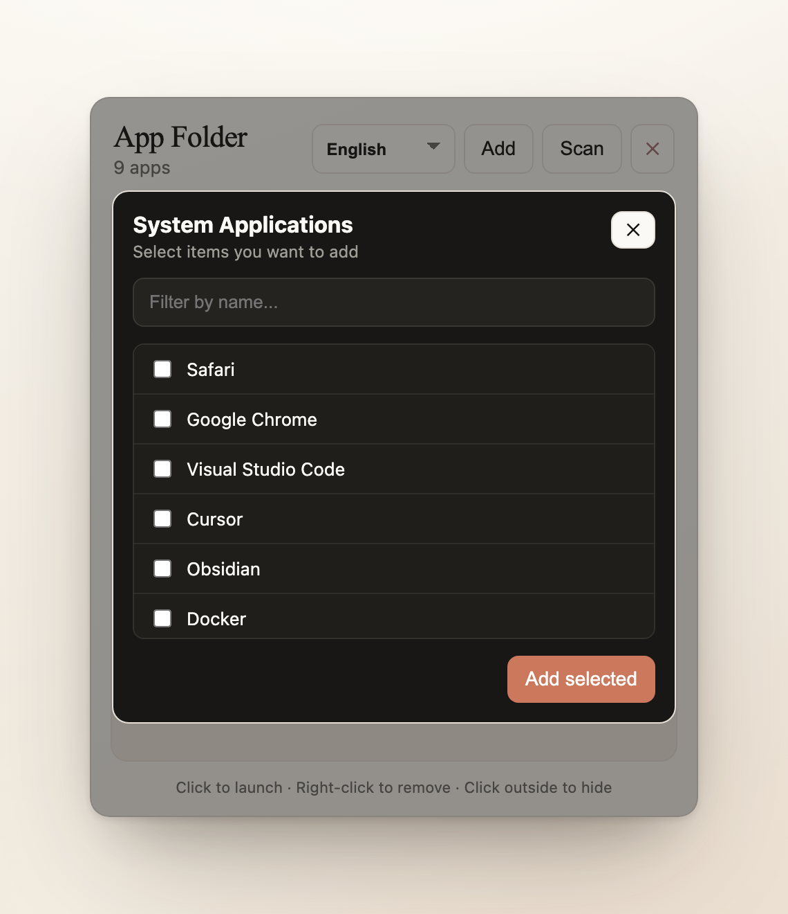
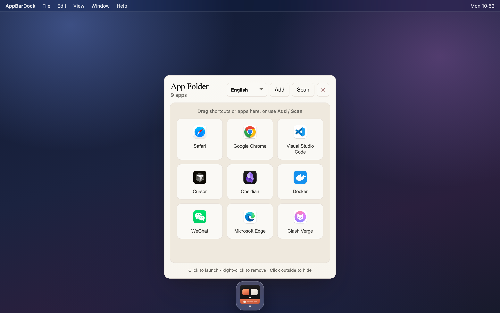

# AppBarDock

贴在屏幕底部的应用启动面板。把常用应用收进一个悬浮窗口，单击启动、按使用频率自动排序。

Electron + TypeScript + Vite，支持 macOS / Windows / Linux。

[](https://github.com/xiguazhiPrince/app-bar-dock/actions/workflows/release.yml)
[](https://github.com/xiguazhiPrince/app-bar-dock/releases/latest)

## 最佳使用方法

1. 把这个图标添加到任务栏里（macOS 上是 Dock）；
2. 把其他应用的图标从任务栏里移除；
3. 以后想打开什么程序，直接点击这个图标就可以打开了。



## 功能

- **扫描系统应用**：列出已安装应用，勾选即可加入面板。Windows 读开始菜单快捷方式，macOS 读 `/Applications`，Linux 读 `.desktop` 文件。
- **拖拽添加**：把文件、快捷方式或 `.app` 直接拖进面板。
- **图标解析链**：三级后备（Shell → 缩略图 → 文件图标），带磁盘缓存；能识别「只有泛型占位图标」的程序，改用首字母色块。
- **按使用频率排序**：记录启动次数，最常用的排在前面；并列时按加入顺序。
- **右键移除**：两次确认，防误删。
- **中英双语**：跟随系统语言，手动切换会记住。
- **悬浮窗口**：无边框、透明、圆角，macOS 用 `vibrancy` 毛玻璃；失焦 180ms 后自动隐藏，点击 Dock 图标可切换显示/隐藏。
- **单实例**：重复启动只会切换现有窗口。

## 界面

<table>
<tr>
<td width="50%"></td>
<td width="50%"></td>
</tr>
<tr>
<td align="center">简体中文</td>
<td align="center">扫描系统应用</td>
</tr>
</table>



> 预览图为按项目真实样式（`src/index.css` + `index.html`）渲染的效果图，图标取自真实应用，非运行截图。

## 平台支持

| 平台 | 应用扫描 | 图标提取 | 启动方式 | 预编译包 |
|---|---|---|---|---|
| **macOS** | `/Applications`、`~/Applications` 下的 `.app` | 原生缩略图 → 文件图标 | `open` | ❌ 需自行构建 |
| **Windows** | 用户与全局开始菜单里的 `.lnk` | Shell（koffi，worker 线程）→ 缩略图 → 文件图标 | `shell.openPath`，失败回退 `start` | ✅ 安装器 + 绿色版 |
| **Linux** | `~/.local/share/applications`、`/usr/share/applications` 的 `.desktop` | 缩略图 → 文件图标 | `shell.openPath`，失败解析 `Exec=` | ❌ 需自行构建 |

Windows 是图标能力最完整的平台：只有它能通过 Shell 拿到 256px 图标和 `.lnk` 自带的 `IconLocation`。

## 下载与安装

### Windows

到 [Releases](https://github.com/xiguazhiPrince/app-bar-dock/releases/latest) 下载：

| 文件 | 说明 |
|---|---|
| `appbardock-<version> Setup.exe` | **安装器**。双击安装，装到 `%LOCALAPPDATA%`；不提供安装路径选择，且无卸载向导之外的配置项 |
| `appbardock-win32-x64-<version>.zip` | **绿色版**。解压后直接运行其中的 `appbardock.exe`，不写注册表 |

> ⚠️ 当前构建**未做代码签名**，首次运行可能被 SmartScreen 拦下，需要「更多信息 → 仍要运行」。

### macOS / Linux

暂无预编译包，需要从源码运行（见下一节）。CI 目前只构建 Windows。

## 快速开始

要求 Node.js ≥ 22，包管理器为 pnpm（版本由 `packageManager` 字段锁定为 10.33.2，用 Corepack 或 `npm i -g pnpm` 装即可）。

```bash
pnpm install
pnpm start        # 开发模式，热更新
```

其他脚本：

```bash
pnpm lint         # ESLint
pnpm package      # 只打包，不产出安装器
pnpm make         # 打包 + 生成安装器
```

## 打包与发布

### 本地打包

```bash
pnpm make
```

产物在 `out/make/` 下：

- Windows：`squirrel.windows/x64/*.exe`（安装器）、`zip/win32/x64/*.zip`（绿色版）
- macOS：`zip/darwin/*.zip`
- Linux：`deb/`、`rpm/`

**必须在目标系统上打包，不能交叉编译** —— `koffi` 是原生模块，Squirrel 也需要 Windows 工具链。

### GitHub Actions

[.github/workflows/release.yml](.github/workflows/release.yml) 在 `windows-latest` 上构建：

| 触发 | 结果 |
|---|---|
| push 到 `main` | 构建并上传为 workflow artifact（不创建 Release，避免版本号冲突） |
| push `v*` 标签 | 构建并创建 **GitHub Release**，版本号取自标签 |

发版流程：

```bash
git tag v1.0.1
git push github v1.0.1
```

工作流会先用标签覆盖 `package.json` 的 `version`，再打包，所以产物文件名和 Release 标签始终一致。

> `package.json` 里的 `pnpm.onlyBuiltDependencies` 必须包含 `electron-winstaller`。pnpm 默认拦截依赖的安装脚本，一旦被拦，Squirrel 的 `vendor/7z.exe` 不会解出来，打包会以 `The system cannot find the file specified` 失败。工作流里有一道前置校验专门兜这个坑。

## 工作原理

1. **扫描**：按平台外壳（`src/main/scanners.ts`）枚举开始菜单 `.lnk` / `.app` / `.desktop`。
2. **图标**：`src/main/icon-service.ts` 依次尝试 **Shell**（Windows 原生，跑在 `icon-worker.ts` 的 worker 线程里）→ **原生缩略图** → **文件图标**。
   命中后按「路径 + 文件标识」缓存到 `userData/icon-cache`；若检测到返回的是系统通用占位图标，则判为「无自身图标」，前端改用首字母色块。
3. **存储**：条目存在 `userData/app-folder-items.json`，字段为 `id / label / kind / path / addedAt / launchCount`。
4. **排序**：`sortItems` 按 `launchCount` 降序、`addedAt` 升序返回**新数组**，文件本身始终保持追加顺序，排序只影响展示。
5. **窗口**：`src/main/position-window.ts` 把窗口按 440×520 的比例贴在工作区底部居中、离底边 10px 处。

数据目录：

- macOS：`~/Library/Application Support/appbardock`
- Windows：`%APPDATA%\appbardock`

## 项目结构

```
src/
  main.ts              主进程：窗口、菜单、单实例、失焦隐藏
  preload.ts           contextBridge 暴露的 API
  renderer.ts          渲染进程 UI 逻辑
  index.css            全部样式（无 UI 框架）
  i18n.ts              中英文案
  shared/ipc.ts        IPC 通道名与类型
  main/
    scanners.ts        按平台枚举已安装应用
    icon-service.ts    图标解析链 + 缓存 + 占位图识别
    icon-native.ts     Windows Shell 图标提取
    icon-worker.ts     worker 线程入口
    win-shell-icon.ts  koffi 绑定的 Win32 调用
    launch.ts          启动目标（各平台回退逻辑）
    store.ts           条目持久化与排序
    position-window.ts 窗口定位
    ipc-handlers.ts    IPC 注册
assets/               icon.icns / icon.ico / icon-<n>.png
tools/build-icons.py  从美术原图生成各平台图标
DESIGN.md             视觉规范参考
```

## 已知限制

- Windows 构建未签名，SmartScreen 会告警；macOS 构建未签名/公证，分发给别人需要手动放行。
- 安装器是 Squirrel 的一键安装：固定在 `%LOCALAPPDATA%`，不能选目录。要经典向导（MSI）需换 `@electron-forge/maker-wix`。
- 没有实现自动更新。`electron-squirrel-startup` 只负责安装/卸载时的快捷方式处理。
- 只构建 x64，没有 arm64 产物。
- Linux 的 `.desktop` 解析只取 `Exec=` 行，未处理 `TryExec`、`Path`、`Terminal=true` 等字段。

## 许可证

MIT
